# Party arcade: games for 10 or more phones

Status: ideas, 24 November 2026. Nothing here is implemented. Each idea needs a full design brief before work starts. The pictures are generated concept art that shows mood only. They are not game assets and not screen designs.

## The brief

Sofa Arcade today seats two phones (Jon and Lydia) and one TV. This document proposes arcade games for a full living room: 4 to 16 phones, one TV, short rounds, loud reactions. Guests join with the QR code and need no account and no install.

## Design rules for a crowd

These rules shaped every idea below.

1. **Eyes on the TV.** A phone is a controller, not a second screen. The player must be able to play without looking down: one large touch zone, tilt, shake or hold. Private information on the phone is the exception and must be short.
2. **Ten seconds to learn.** A guest who walks in mid-party must understand the game from one sentence on the TV and one practice motion.
3. **Nobody waits.** A player who is knocked out gets a new job in the same round (a ghost, a paw, a heckler). No one watches for more than 20 seconds.
4. **Join and leave at any time.** A round must still work when a phone locks, a guest leaves or a new guest arrives. Player count changes the board size, not the rules.
5. **Find yourself at once.** With 16 avatars on a TV, each player needs a strong identity: scarf colour, pattern, a name tag and a phone screen tinted the same colour.
6. **Short rounds, many rounds.** 45 to 120 seconds per round. A set of five rounds makes a game. The TV shows a podium, then the next round starts.
7. **Fair on bad Wi-Fi.** Prefer inputs that tolerate 100 ms of delay (tilt, hold, rhythm windows judged on the phone clock). Avoid pixel-exact twitch aiming.
8. **One screen, one camera.** Every player must stay visible on one TV. This means arenas, lanes, or a race camera that follows the pack and drops whoever falls off the screen. Split screen does not work for 10 players.
9. **Theme is free.** Part A keeps the mice and Lala. Part B uses other worlds (toy cars, paper planes, neon ships). The collection shelf can hold both.

## Part A: ideas in the Sofa Arcade world

Guests are the neighbourhood mice, each with a generated scarf and name. Lala the cat stays the star disruptor, and in some games a player controls her. Each idea lists the phone input, the TV view, how it scales and why it is fun. "Reuse" names existing Sofa Arcade parts that shorten the work.

### Free-for-all

#### 1. Dust Bunny Sumo

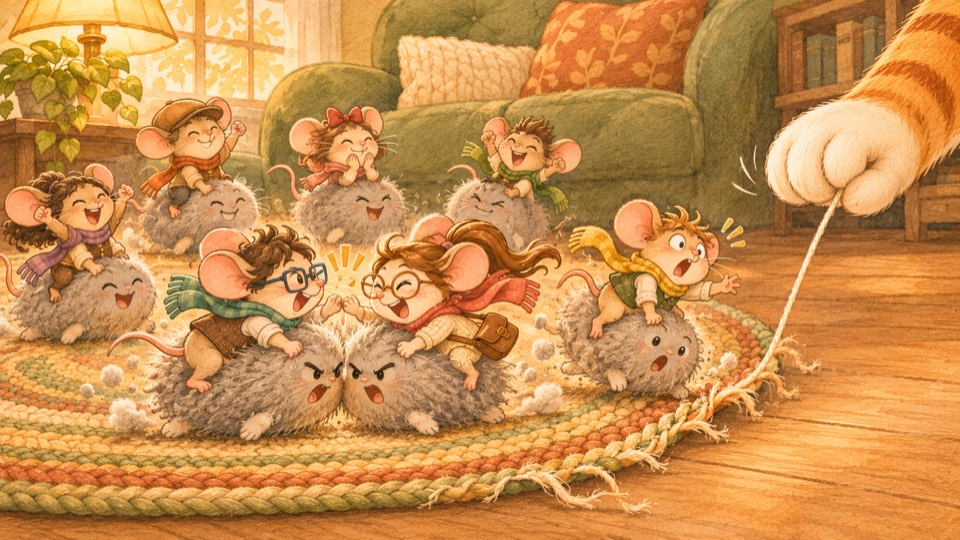

Every mouse rides a dust bunny on a round rug. Tilt the phone to roll. Bump the others off the edge. The rug shrinks as Lala pulls its threads.

- **Phone:** tilt to roll; tap to dash (short cooldown).
- **TV:** top-down rug, 16 fuzzy balls, rising chaos.
- **Knocked out:** you become a draught under the door: swipe to send a gust across the rug once every few seconds.
- **Scales:** rug area grows with player count. Works from 3 to 16.
- **Reuse:** Gravity Orchard tilt input, physics and the 20 Hz realtime coordinator.
- **Why:** the simplest possible verb, instant rivalries, 60-second rounds.

#### 2. Yarn Tangle

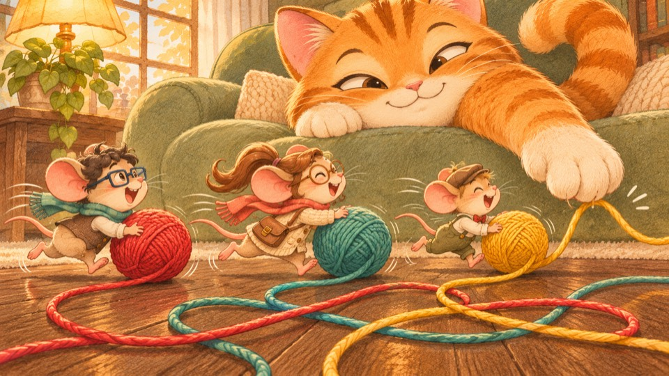

Each mouse runs across the floor and unrolls a ball of yarn behind it. Touch any yarn and you trip. The floor fills with lines until one mouse is left.

- **Phone:** left and right thumb zones to turn. The mouse never stops.
- **TV:** a dark wooden floor that fills with bright yarn in each player's colour.
- **Knocked out:** you control one of Lala's paws and can bat one strand away to open a gap, for a friend or for mischief.
- **Scales:** 4 to 12. Above 8, play two heats and a final.
- **Why:** readable from across the room, tense endings, beautiful final picture of the round.

#### 3. Crumb Rush

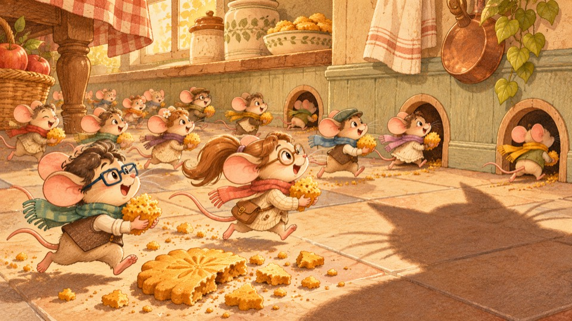

A dropped biscuit shatters across the kitchen floor. Mice grab crumbs and carry them home. A carried pile slows you down and can be bumped loose. Lala's shadow crosses the floor on a schedule and scatters anyone under it.

- **Phone:** virtual stick under the thumb; tap to drop or throw the pile.
- **TV:** one kitchen, home holes around the edge, a clear Lala forecast (the existing forecast idea from Sofa Kingdoms, in real time).
- **Scales:** 4 to 16 with more biscuits and more holes.
- **Reuse:** Sofa Kingdoms theme, crumb scoring and pounce forecast.
- **Why:** it is the arcade form of the game the collection began with: greed against safety.

### Teams

#### 4. Blanket Fort Siege

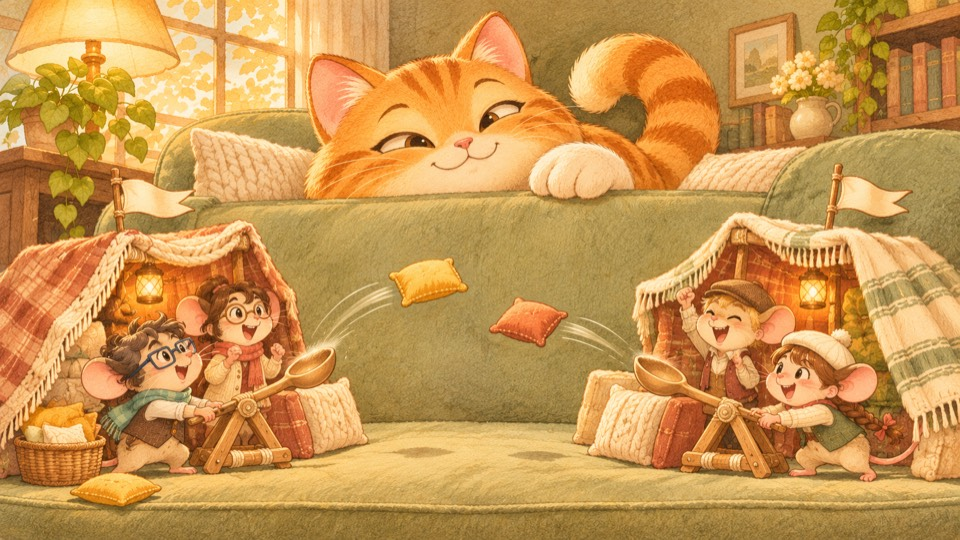

Two forts made of cushions face each other across the sofa. Each team loads pillows and fires them. Knock down the other fort's flag.

- **Phone:** pull back and release, like a slingshot. Angle and power come from the drag. Each phone also sees one job button: fire, rebuild or shield.
- **TV:** side view, two forts with real physics, pillows in the air.
- **Scales:** 2 against 2 up to 8 against 8. Teams balance automatically when guests join.
- **Why:** team shouting, clear roles for players who do not want to aim, slow-motion replay of the winning hit.

#### 5. Tug of Yarn

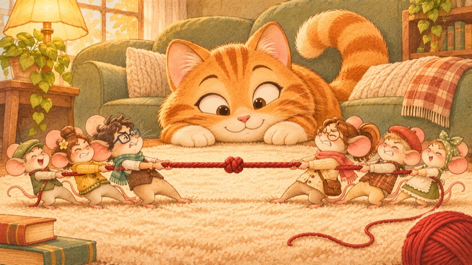

Two teams pull one strand of yarn. Speed does not win: timing does. The team that taps most closely together on the beat pulls hardest.

- **Phone:** one full-screen button. Tap on the beat.
- **TV:** the strand, a marker that moves toward the losing side, a pulse that shows each team's unity.
- **Scales:** any number. Odd teams are normalised by using the team's average.
- **Why:** 30 seconds, no skill barrier, the whole room chants the count. A good first game of the night.

#### 6. Paint the Rug

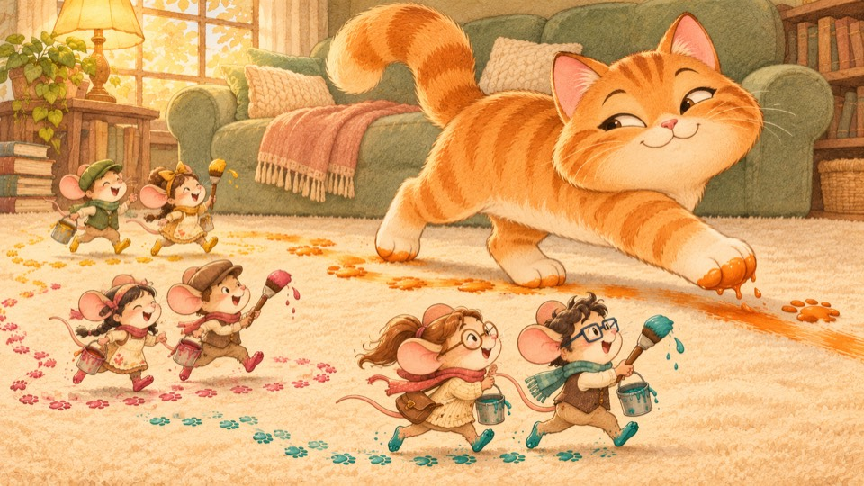

Teams of mice with paint on their feet run over a plain rug. The team that covers the most area when the timer ends wins. Lala walks through and smears a stripe in her own orange.

- **Phone:** tilt or stick to run; tap to shake off a splash.
- **TV:** the rug as a growing painting, a live area bar per team.
- **Scales:** 2 to 4 teams, up to 16 players.
- **Why:** the score is the picture. Weak players still add paint, so nobody feels useless.

### Everyone together

#### 7. Teapot Tilt

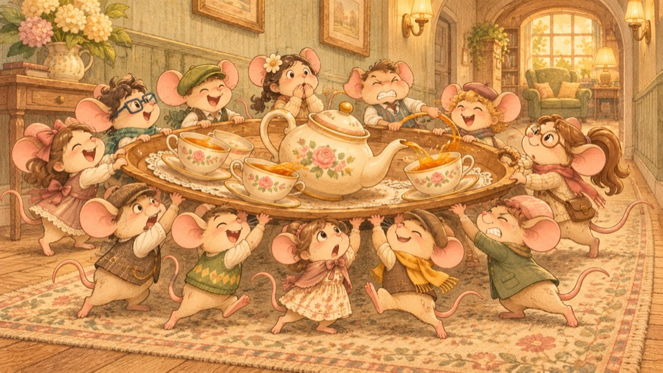

All the mice carry one tray with a full teapot through the house. Every phone's tilt is added together. Spill too much tea and the run fails.

- **Phone:** tilt only.
- **TV:** the tray, the route, a spill meter, and a small arrow per player that shows who leans which way.
- **Twist for later rounds:** half the room controls left and right, the other half forward and back. Or one secret mouse is thirsty and wins if the tea spills.
- **Scales:** any number. More players means a heavier, slower tray.
- **Reuse:** Gravity Orchard tilt pipeline and stage structure.
- **Why:** the Gravity Orchard feeling for a whole room. The arrows make blame funny, not hidden.

#### 8. Kitchen Band

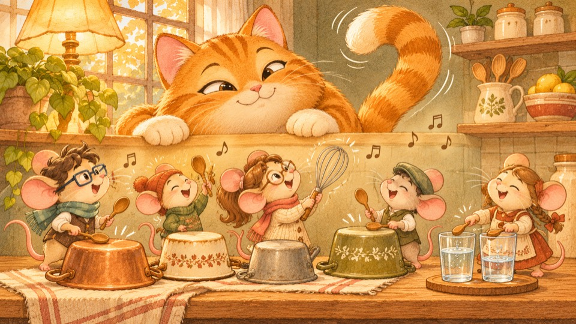

The mice form a band from kitchen things. Each phone becomes one instrument: a pot, two spoons, a glass, a whisk. Notes fall on the TV in a lane per section. The song only sounds complete when every section plays.

- **Phone:** one or two large pads. The phone judges timing on its own clock, so Wi-Fi delay does not matter.
- **TV:** falling notes per section, a shared combo meter, the band on stage.
- **Scales:** 3 to 16. Sections share parts when the room is large.
- **Reuse:** the existing music and effects engine and its composition notes.
- **Why:** cooperative, musical, and it gives the collection's audio work a starring role.

#### 9. Long Tail

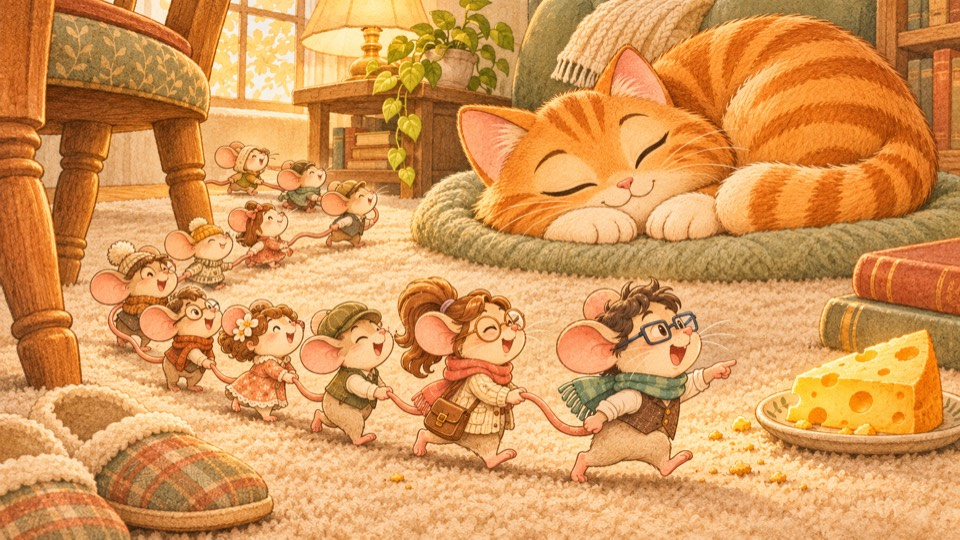

All the mice hold tails and form one long line. Only the first mouse steers. Every 10 seconds the lead passes to the next mouse. Collect cheese, do not cross your own line, do not wake Lala.

- **Phone:** left and right while you lead; a "squeak" button for everyone else that flashes your segment (to warn or to distract).
- **TV:** one growing line through a maze of furniture.
- **Scales:** 4 to 16. A longer line is harder, so large groups get more room.
- **Why:** shared fate, a clear moment in the spotlight for each guest, loud backseat driving.

### One against many

#### 10. Pounce!

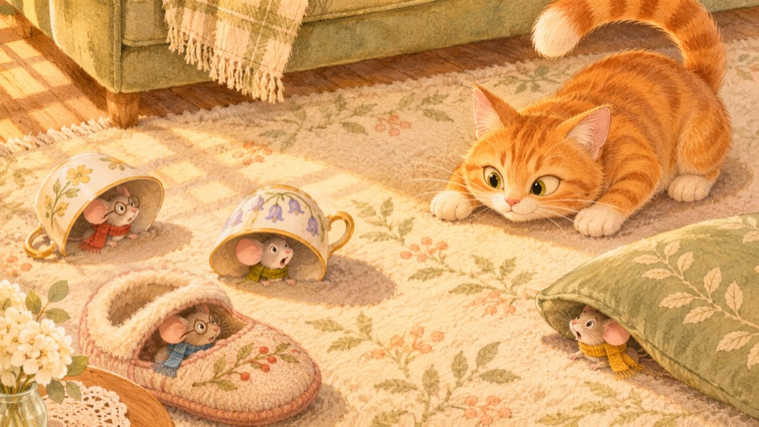

One player is Lala. Everyone else is a mouse crossing the living room to the cheese. Mice hide under cups, slippers and cushions. Lala has three pounces per round.

- **Lala's phone:** a paw cursor and a pounce button. Only this phone shows a faint hint of where sound came from.
- **Mouse phones:** stick to move; hold to hide and stay silent. Moving makes noise.
- **TV:** the room from above. Hidden mice are not drawn at all.
- **Scales:** 4 to 12. With 9 or more, a second player controls Lala's tail as a sweeper.
- **Needs:** per-role state projection, which Odd Laws already uses for sealed bids.
- **Why:** the player who is Lala becomes the villain of the room for 90 seconds, then the role moves on.

#### 11. Don't Wake Lala

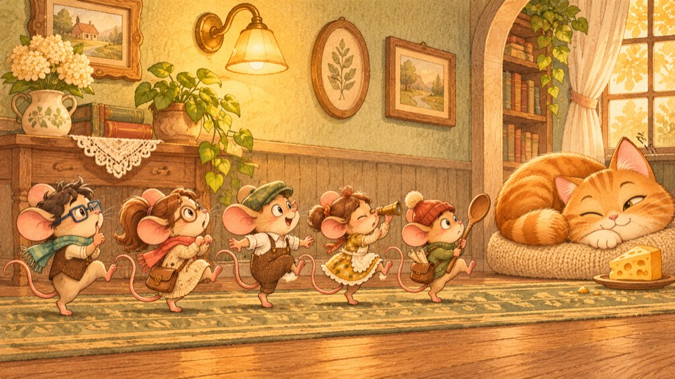

Lala sleeps at the end of the hallway beside the cheese. Hold the button to creep forward. When her ear twitches, she is about to look: let go and hold your phone perfectly still. The phone's motion sensor checks. Anyone who moves goes back to the start.

- **Phone:** hold to move; stay physically still when she looks.
- **TV:** the hallway side on, all mice in lanes, Lala's ear and eye as the only signal.
- **Scales:** any number, 3 to 20. It is the easiest game here to build.
- **Why:** the game happens in the room, not on the screen: a sofa full of people who freeze and try not to laugh.

### Hidden in the crowd

#### 12. Which Mouse Am I?

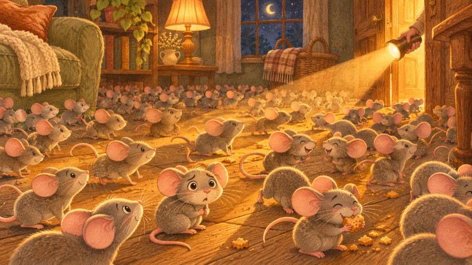

The floor is full of identical grey mice. Some are players and most are computer mice that wander. Your first task is to find yourself. Then reach the cheese without looking like a player, because one player is the housekeeper with a torch and three chances to catch a real mouse.

- **Phone:** stick to move. No picture of the floor on the phone.
- **TV:** fifty identical mice and one torch beam.
- **Scales:** 4 to 12, with more computer mice for more players.
- **Needs:** per-role projection so that no browser learns which mice are real.
- **Why:** the quietest and most tense game in the list. It makes a good change of pace between loud rounds.

### The frame that holds a party night

#### 13. Snack Stack

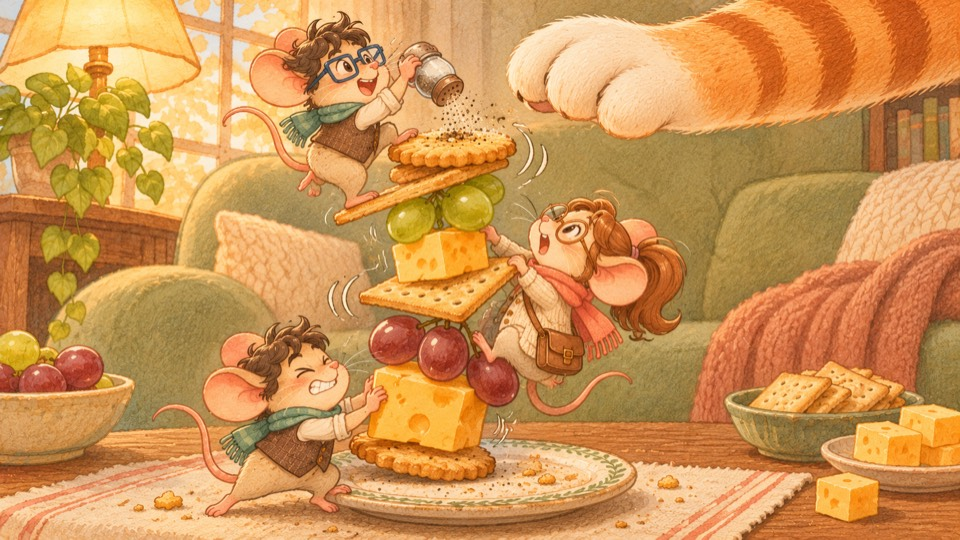

A fast run of five-second challenges. The TV shouts one instruction and everyone does it at once: shake the pepper, tap exactly seven times, tilt until the picture hangs level, trace the crack in the plate, hold still, pass the phone to the left. Points for speed and accuracy. Lala interrupts with a bonus round.

- **Phone:** whatever the challenge needs: tap, hold, shake, tilt, swipe, trace.
- **TV:** the instruction in huge type, a live count of who has finished, a ladder of scores.
- **Scales:** any number.
- **Why:** it is the best frame for variety. Each new challenge is a small, separate piece of work, so the set can grow for months. Start with 20 challenges.

#### 14. Musical Cushions

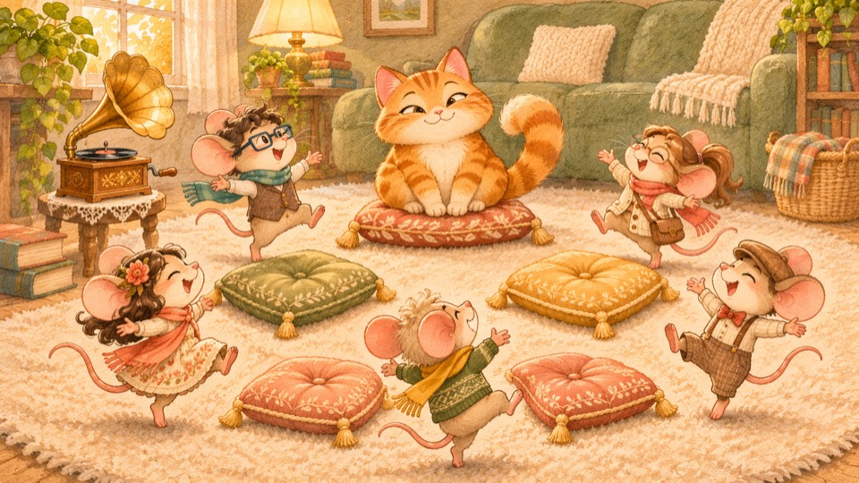

Mice dance in a circle while the music plays. When the music stops, run to a cushion. There is always one cushion too few. Between rounds, the mice who are out choose a trick for the next round: a slippery floor, a cushion that Lala already sits on, the lights off.

- **Phone:** tap in rhythm to dance (it charges your sprint); stick to run when the music stops.
- **TV:** the circle, the cushions, the freeze.
- **Scales:** 5 to 16.
- **Reuse:** the music engine, which can already stop and start a track exactly.
- **Why:** everybody knows the idea already, and the trick vote keeps eliminated players powerful.

## Part B: ideas in other worlds

On 24 November 2026 I searched X for games that people built with Claude Opus and Fable. What the popular posts show:

- **Kart and car racers are the most common showcase**, often built from one prompt, in 3D with Three.js: several kart racers, a Formula 1 game that later added real-time multiplayer, and a racer on the town-map play rug that many children had.
- **Car football with real physics** (Three.js, the Rapier physics library, multiplayer through Cloudflare), with stunt park and time attack modes.
- **Low-poly 3D worlds**: a downhill skateboard game, a sailing game, a wizard sandbox, a cosy island builder, a cosy fishing game.
- **Almost all of them are for one player with a keyboard.** I found no popular example of a room of phones that controls one TV. That gap is the opening for Sofa Arcade.

Lessons for us: low-poly 3D and simple shapes look good without hand-drawn art; a physics library gives fun collisions for little work; racing and ball games are understood at once.

#### 15. Rug Rally

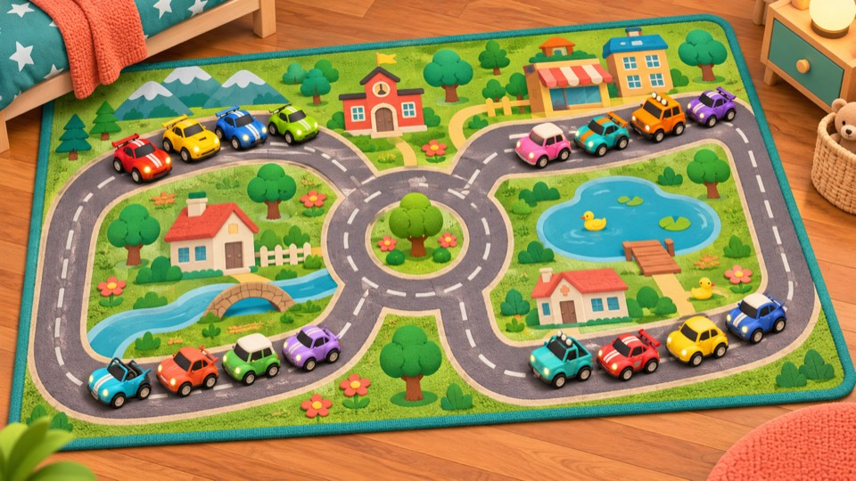

Toy cars race on the town-map play rug: roads, a roundabout, a hospital, a pond. Up to 16 cars on one screen. The camera follows the pack, and a car that falls off the screen loses a life and returns in the pack.

- **Phone:** hold it like a steering wheel and tilt to steer; thumb for boost. Touch steering as a fallback.
- **TV:** tilted top-down 3D view of the rug with low-poly toy cars.
- **Scales:** 2 to 16.
- **Why:** nostalgia, instant understanding, and it is the genre these models build best.

#### 16. Bumper Ball

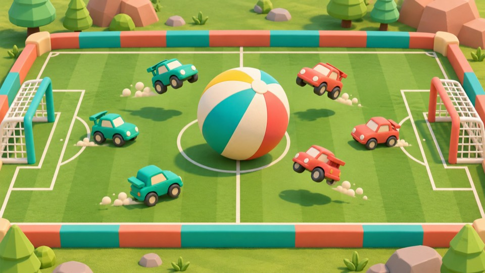

Football with toy cars and one giant beach ball. Two teams of up to 8.

- **Phone:** tilt to steer, one thumb to boost, one to jump.
- **TV:** a small walled pitch from a high side camera so that every car stays visible.
- **Scales:** 4 to 16. With 12 or more, add a second ball.
- **Why:** real physics makes chaos funny, and weak players still matter because they get in the way.

#### 17. Paper Planes

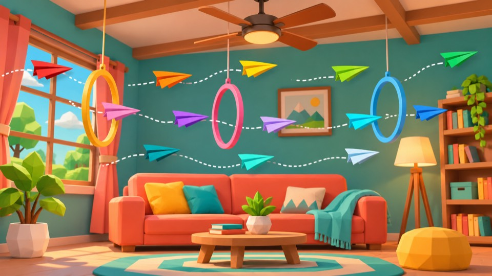

Everyone launches a paper plane from the sofa and glides through a living room: through rings, over the lamp, past the fan. Furthest flight wins, or most rings.

- **Phone:** flick the phone forward to launch (motion sensor), then tilt to bank and pitch.
- **TV:** side-scrolling 3D room; all planes in one frame; a ghost line shows the best flight so far.
- **Scales:** any number. Flights take 20 seconds, so it also works in turns of four.
- **Why:** the launch is a real physical gesture. People stand up to throw.

#### 18. Neon Swarm

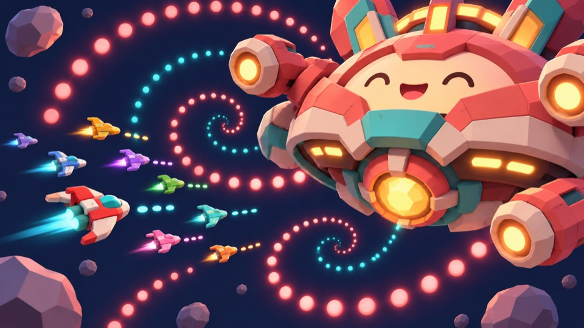

A cooperative shooter. Every player is a small glowing ship. One huge boss fills half the TV and fills the screen with slow, readable bullet patterns. Fallen players return when a friend flies over them.

- **Phone:** one thumb moves; the ship fires by itself. A second thumb triggers a shared shield that needs three players at once.
- **TV:** dark background, bright ships in each player's colour, big patterns.
- **Scales:** 3 to 16. Boss health and pattern density follow the player count.
- **Why:** everyone wins or loses together, so a new guest is helped, not hunted.

#### 19. Glyph Duel

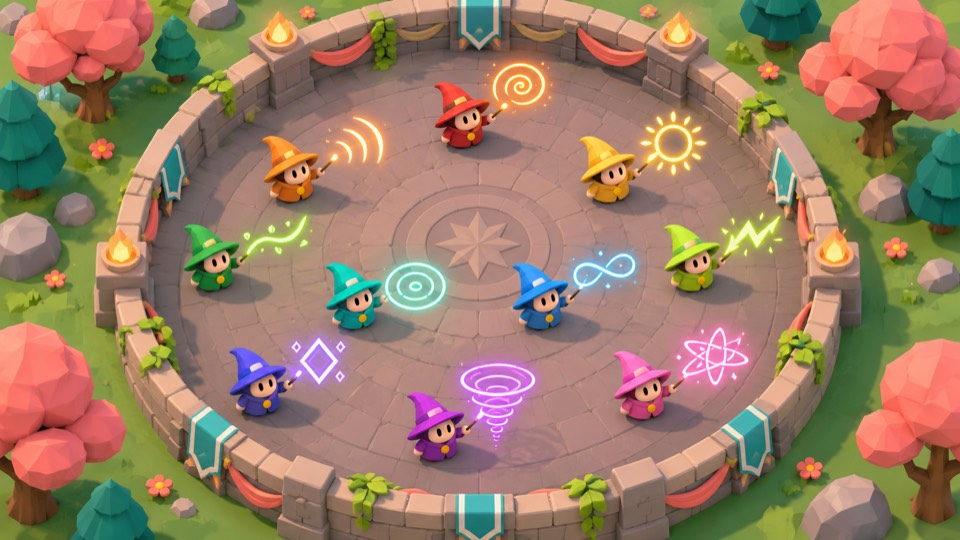

Ten wizards in a round arena. You cast by drawing: a line throws a bolt, a circle raises a shield, a zigzag calls lightning, a spiral makes a whirlwind.

- **Phone:** left thumb moves, right thumb draws the glyph.
- **TV:** top-down arena, large readable spell effects.
- **Scales:** 3 to 12, free-for-all or teams.
- **Why:** drawing a spell under pressure is a skill that people enjoy learning in front of friends.

#### 20. Wall of Paddles

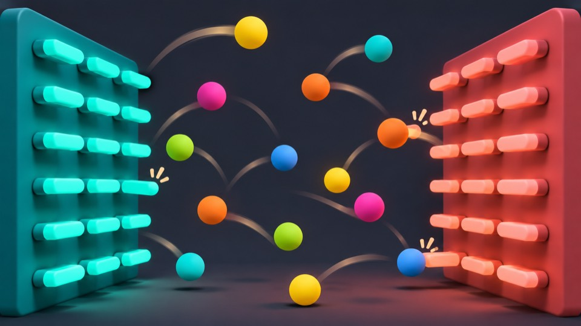

A giant bat-and-ball game. Each team defends one side of the screen, and each player is one short paddle on that wall. Many balls. A ball that passes scores.

- **Phone:** slide one thumb up and down.
- **TV:** two walls of small paddles, a storm of balls, power-ups that widen, split or curve.
- **Scales:** 2 against 2 up to 10 against 10. It is the easiest Part B game to build.
- **Why:** the oldest video game idea becomes a team sport, and a gap in the wall is always somebody's fault.

#### 21. Downhill Jam

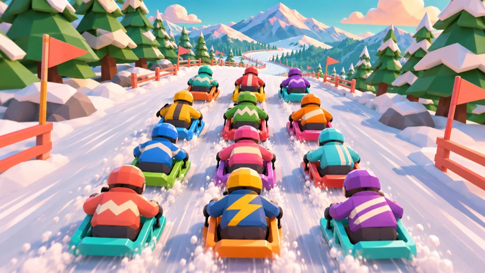

Twelve riders on sleds race down one mountain on one screen. Slipstream the rider in front, bump at the corners, take the risky shortcut. Fall off the back of the screen and you lose a heart.

- **Phone:** tilt to steer, tap to jump, hold to tuck for speed.
- **TV:** behind-the-pack camera, low-poly snow, big speed lines.
- **Scales:** 3 to 12.
- **Why:** a pack camera keeps the race close until the last second.

#### 22. Harbour Regatta

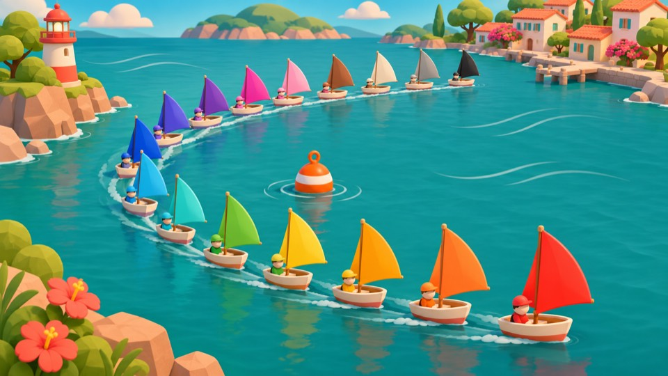

Small sailing boats race round three buoys while the wind shifts. A calm game between loud ones.

- **Phone:** tilt to steer; a thumb slider trims the sail. The TV shows the wind.
- **TV:** top-down bay, boats with coloured sails, wind as moving lines on the water.
- **Scales:** 3 to 16.
- **Why:** a little real skill (read the wind) and a relaxed pace give older guests and children a game they can win.

#### 23. Floor Is Falling

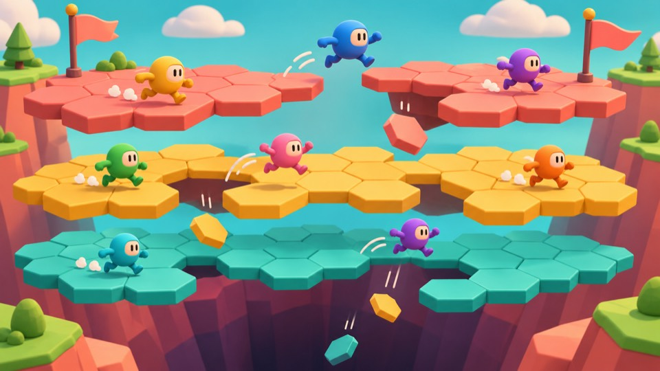

A floor of hexagon tiles over a pit. A tile falls a moment after someone steps on it. Keep moving. Last player standing wins. Three floors are stacked, so a fall is not the end at once.

- **Phone:** one stick and a jump button.
- **TV:** tilted 3D view of all three floors.
- **Knocked out:** you drop bowling balls from above.
- **Scales:** 4 to 16.
- **Why:** simple rules, fast rounds, constant close calls.

#### 24. Catch of the Day

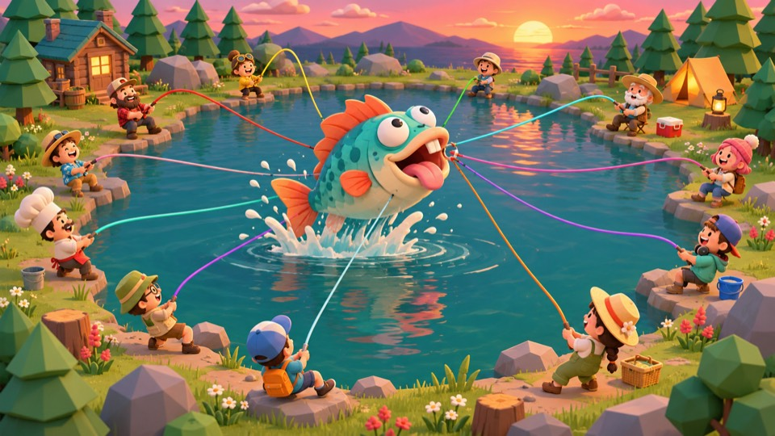

A fishing contest on a small lake. Flick the phone to cast, wait for the pull, then reel. Big fish need two players on the same line.

- **Phone:** flick to cast (motion sensor), circle a thumb to reel, a short buzz pattern on screen and sound when a fish bites (no vibration needed).
- **TV:** the lake from above, each line in its player's colour, a leaderboard of strange fish.
- **Scales:** any number.
- **Why:** a cosy game with real gestures, good for the end of the night.

## Comparison

| # | Game | Players | Round | Main input | Mood | Build size |
| --- | --- | --- | --- | --- | --- | --- |
| 1 | Dust Bunny Sumo | 3–16 | 60 s | Tilt | Rowdy | Small |
| 2 | Yarn Tangle | 4–12 | 60 s | Two thumbs | Tense | Small |
| 3 | Crumb Rush | 4–16 | 90 s | Stick | Greedy | Medium |
| 4 | Blanket Fort Siege | 4–16 | 120 s | Drag and release | Team shouting | Large |
| 5 | Tug of Yarn | 4–20 | 30 s | One button | Chant | Small |
| 6 | Paint the Rug | 4–16 | 75 s | Tilt or stick | Colourful | Medium |
| 7 | Teapot Tilt | 3–20 | 90 s | Tilt | Cooperative panic | Small |
| 8 | Kitchen Band | 3–16 | 120 s | Rhythm pads | Joyful | Large |
| 9 | Long Tail | 4–16 | 120 s | Left and right | Backseat driving | Medium |
| 10 | Pounce! | 4–12 | 90 s | Stick and hide | Hunted | Medium |
| 11 | Don't Wake Lala | 3–20 | 45 s | Hold and freeze | Giggles | Small |
| 12 | Which Mouse Am I? | 4–12 | 90 s | Stick | Quiet tension | Medium |
| 13 | Snack Stack | 3–20 | 5 s each | Everything | Fast and silly | Medium, grows |
| 14 | Musical Cushions | 5–16 | 40 s | Rhythm and stick | Classic | Medium |
| 15 | Rug Rally | 2–16 | 90 s | Tilt as a wheel | Nostalgic race | Medium |
| 16 | Bumper Ball | 4–16 | 120 s | Tilt, boost, jump | Physics chaos | Medium |
| 17 | Paper Planes | 2–20 | 20 s each | Flick and tilt | Stand up and throw | Small |
| 18 | Neon Swarm | 3–16 | 120 s | One thumb | Cooperative | Medium |
| 19 | Glyph Duel | 3–12 | 75 s | Move and draw | Show-off skill | Medium |
| 20 | Wall of Paddles | 4–20 | 60 s | One thumb slide | Team blame | Small |
| 21 | Downhill Jam | 3–12 | 75 s | Tilt, jump, tuck | Close race | Large |
| 22 | Harbour Regatta | 3–16 | 120 s | Tilt and trim | Calm | Medium |
| 23 | Floor Is Falling | 4–16 | 45 s | Stick and jump | Close calls | Medium |
| 24 | Catch of the Day | 2–20 | 120 s | Flick and reel | Cosy | Small |

## Arcade means animation

Yes: these are arcade games, so they need real animation. The present games are mostly turn-based. They move illustrated cut-outs with CSS when the state changes. That method does not carry an arcade game with 16 bodies that move 60 times a second. The TV needs a game renderer.

### What must exist

1. **A render loop on the TV.** One canvas that draws 60 frames a second (WebGL through a small library: PixiJS for 2D, Three.js for 3D). The page layout around it stays HTML.
2. **Smooth motion between server updates.** The host simulates at a fixed rate (the Gravity Orchard coordinator runs at 20 updates a second). The TV draws positions between the last two updates so that movement looks smooth, and each phone shows its own input at once.
3. **"Juice".** The small effects that make arcade games feel good: squash and stretch, a short freeze on a hit, screen shake, particles, trails, bounce on landing, a number that pops out when you score. This is a shared kit, written once and used by every game. It must respect the reduced-motion setting.
4. **Sound per event.** Each hit, pickup and countdown has a sound, mixed by the existing audio engine on the TV.
5. **Phones stay simple.** A controller screen is a colour, a name, one or two touch zones and a few state words. Almost no animation and no drawing loop, so old phones stay cool and responsive.

### Four ways to make the moving art

| Route | How | Good for | Risk |
| --- | --- | --- | --- |
| **Pixel art written in code** | Each sprite frame is a small grid of letters in a source file, and each letter names a colour role (outline, fur, scarf). The model writes and edits the grids directly. The TV draws them on the canvas at a whole-number scale with smoothing off. | Any Part A or Part B game that can wear a retro look: Dust Bunny Sumo, Crumb Rush, Musical Cushions, Neon Swarm, Floor Is Falling | Low. Frames cannot drift because a run cycle changes only the rows that move. One sprite serves 16 players by changing one palette entry. Sprites are a few hundred bytes, need no image tool, and show as readable diffs in review. Large or detailed characters take more effort than at 16 or 32 pixels. |
| **Shapes and code** | Draw characters from circles, capsules and lines in code, and animate them with code (wobble, lean, squash). Glow and particles do the rest. | Neon Swarm, Wall of Paddles, Dust Bunny Sumo, Yarn Tangle | Low. No art pipeline. Looks deliberate if the palette and motion are consistent. |
| **Low-poly 3D** | Build cars, sleds, boats and rooms from simple 3D shapes in Three.js, with the Rapier library for physics. | Rug Rally, Bumper Ball, Downhill Jam, Floor Is Falling, Paper Planes | Medium. This is what the X examples do well. Needs care with performance on a TV-connected Mac, which is easy, and none on phones. |
| **Illustrated cut-out puppets** | Generate each character once as separate parts (head, body, arms, tail) with the image tool, then animate the parts with code as a puppet. | Part A games that must look like Sofa Kingdoms | Medium. Keeps the storybook style and lets one drawing make many poses. Generated frame-by-frame sprite sheets are the alternative, but the frames drift between poses and need manual repair. |

Recommended: pixel art written in code for character games, and shapes-and-code or low-poly 3D where the subject is a vehicle or an abstract shape. Keep illustrated art for covers, lobbies and podiums. That puts animation effort where code is strong and keeps the warm style where players look longest.

**Proof.** [coded-sprite-proof.mjs](party-arcade-art/coded-sprite-proof.mjs) defines one 16 × 16 mouse as letter grids, with five frames (stand, three run frames, jump) and 16 scarf colours. It writes the sheet below with no packages and no image tool. It is a first sketch, not final art: it shows that the method works and that all 16 players stay distinct.

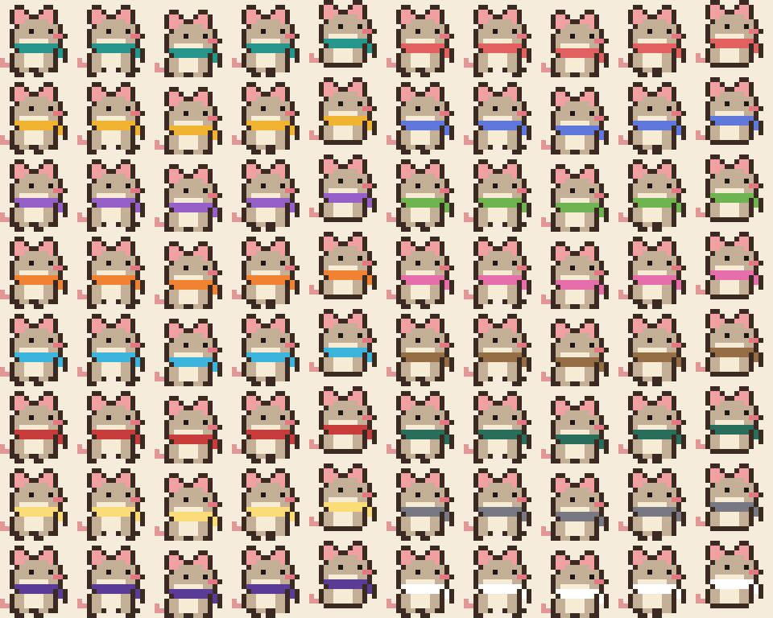

### Proof before commitment

Before any full game: one "arcade kit" prototype with 16 simulated players on the TV (the render loop, interpolation, juice kit and party lobby), measured at 60 frames a second on Jon's Mac while it casts to the TV. Don't Wake Lala and Wall of Paddles are the two cheapest games to build on that kit.

## What the platform needs first

The games above share one set of platform changes. This work comes before any of them.

1. **Seats.** `server/rooms.mjs` stores exactly two seats, `jon` and `lydia`. Party rooms need a list of 2 to 16 or more seats with generated identities, while two-seat rooms keep their present shape and old rooms keep working.
2. **Lobby.** One QR code, a wall of mice on the TV that fills as guests join, a "start when ready" control for the host, a name and scarf picker on the phone that takes 5 seconds.
3. **Late join, leave and reconnect.** A new guest waits for the next round. A phone that sleeps keeps its mouse for 30 seconds.
4. **Realtime budget.** The Gravity Orchard coordinator sends each phone a full snapshot 20 times a second. For 16 phones, controllers must receive only what they need (their own state and round events), and the TV receives the full scene.
5. **Connection limits.** The security work on branch `improve/security-hardening` caps the host at 24 event streams in total and 64 sockets. Those limits were sized for two phones and must be raised and re-tested for 16 phones and a TV.
6. **Per-role projection.** Pounce!, Which Mouse Am I? and the secret-role twist in Teapot Tilt need server-side projection so that a browser never receives what its player must not know.
7. **Arcade kit.** The TV render loop, snapshot interpolation and juice effects described in "Arcade means animation".
8. **Round and podium frame.** One shared module for countdown, round timer, results, podium and "next game" so that each game supplies only its own play.
9. **Identity system.** 16 scarf colours that stay distinct for colour-blind players (colour plus pattern plus name), and matching phone tints.
10. **TV legibility.** 16 avatars at 3 m: larger sprites, name tags only when useful, strong outlines.
11. **Phones.** Tilt needs a secure page on iPhone (the existing HTTPS trust path) and a permission tap. Every tilt game needs a touch fallback. iPhone browsers do not vibrate, so no game may depend on vibration.

## Recommended first three

1. **Don't Wake Lala.** Smallest build, any player count, and it proves the party lobby, seats and round frame with almost no game logic at risk.
2. **Dust Bunny Sumo.** Reuses the tilt and physics work from Gravity Orchard and proves the realtime budget with 16 moving bodies.
3. **Snack Stack.** Once the frame exists, each challenge is a small separate task, which suits parallel agent work and gives a party the most variety per hour of development.

Then add one team game (Tug of Yarn or Wall of Paddles are the cheapest) and one hidden-role game (Pounce!) to cover every mood in the table.

If the other-world route appeals more, start with **Wall of Paddles** (smallest build, proves the arcade kit), then **Rug Rally** (the strongest first impression) and **Bumper Ball** (reuses the cars and adds physics).

## Open questions for Jon

1. What is the real maximum? 10 phones or 16 changes the lobby and the TV layout.
2. Do party games stay local-only like Gravity Orchard, or must they also run on the hosted Site?
3. Do guests get their own illustrated mice (new art for 16 scarves and patterns), or tinted versions of the present characters?
4. One world or many? Should the shelf mix the mouse games (Part A) with other worlds (Part B), or should party games become their own section with their own look?
5. Which look? Coded pixel art needs no new library and no image tool. Low-poly 3D gives the strongest first impression and matches what these models build well, but it adds two libraries (Three.js and Rapier) to a project that has none today.
6. Is there a "party night" mode that chains games with a running score, or does the host pick each game?
